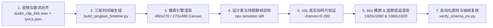

# 《晴天》像素风电影感音乐 MV 全流程制作总结（Workflow Summary）

> 本文档完整总结了将周杰伦《晴天》60 秒高潮片段从早期带游戏 HUD 的方块原型，重构为纯正 **16-bit/32-bit 离散像素小人电影短片** 的全套工程工作流、关键技术选型、避坑经验与复现命令。

---

## 一、 整体生产架构与流程总览



---

## 二、 核心问题诊断与重构方案

| 维度 | 旧版问题 | 重构后方案 |
| :--- | :--- | :--- |
| **人物造型** | 16×16 过于粗糙，或矢量胶囊边缘发糊、刘海遮眼 | **`56×62` 离散像素网格矩阵（`SpriteGrid`）**：自动 4 邻域 `1px` 深色轮廓描边，分叉刘海露额头、`2×3` 高光大眼、腮红、西装/领带/书包与水手服/红领结/白袜/长柄伞高还原 |
| **动态表现** | 镜头切换生硬、部分帧静止感强 | **4 帧像素步行循环 + 12fps 角色律动 + 30fps 平滑运镜**：含伸手轻触、挡雨、撑伞、托腮坐姿、晚霞金边、挥手告别 |
| **界面纯度** | 顶部有 `STAGE`/`BPM` 栏，右侧有 `MEMORY LOG` 游戏框 | **零 HUD 纯电影构图**：仅保留底部无边框暖白歌词字幕 + 逐字浅金扫色，停顿间隙自动隐藏 |
| **背景与景深** | 几何色块单薄；曾出现教室室内下雨错误 | **5 套可复用多层校园场景**：`3×3` 阶梯云朵、`2×2` 簇状树冠、`4×4` Bayer 渐变天空、教室雨滴严格裁剪至窗外、男主透视行走于玻璃窗外 |
| **竖屏适配** | 简单裁剪导致人物被截或重叠 | **独立 `270×480` 竖屏重排版**：地平线上移至 `68%`、强制双人安全横向间距 `minHalfSep`、字幕固定在 `bottom: 22%` 安全区 |
| **像素清晰度** | 分数倍缩放发虚、JPEG 压缩产生像素噪点 | **`4×` 整数倍最近邻缩放**（`image-rendering: pixelated`）+ `--image-format=png` 无损中间帧 + `crf=16` H.264 编码 |

---

## 三、 五大固定校园场景与 12 镜头叙事线（60.0s）

1. **`campus_path`（樱木校园林荫路）**：`S01` 微风并肩走来 → `S02` “我试过握着你手”伸手轻触相视微笑；后段 `S07`~`S08` 雨过天晴丁达尔光柱回归。
2. **`rainy_camphor_road`（雨中樟树马路与斑马线）**：`S03` “但偏偏 雨渐渐”突降斜雨、水洼涟漪、少女撑起长柄伞 → `S04` “大到我看你不见”暴雨中背向拉远。
3. **`classroom_window`（雨天教室窗边）**：`S05` “还要多久”少女坐木桌前托腮望窗外雨滴 → `S06` “我才能在你身边”白纱窗帘吹动、少年从窗外雨廊错身走过。
4. **`playground_overpass_sunset`（操场天桥金色晚霞）**：`S09` “从前从前 有个人爱你很久”夕阳像素金边 → `S10` “把距离吹得好远”晚风起、各自转身拉远。
5. **`streetlamp_rain_corner`（便利店暖黄路灯夜雨街角）**：`S11` “又能再多爱一天”共撑一伞依偎 → `S12` “好像还是说了 拜拜”挥手告别没入夜雨巷口。

---

## 四、 关键工程文件与输出产物清单

### 1. 时间轴生成与数据（Python）
- 构建脚本：[build_qingtian_timeline.py](file:///Users/eagle/Desktop/Video/AI-MV-Workflow/pipeline/storyboard/build_qingtian_timeline.py)
- 产出的 5 份结构化时间轴文件（位于 `AI-MV-Workflow/projects/qingtian_pixel_mv/timeline/`）：
  - `timeline_master.json`（主时间轴，同步镜像至 `mv-studio/src/qingtian_cinema/timeline_master.json`）
  - `timeline_shots.csv`（镜头与动作表）
  - `lyrics_alignment.json`（逐字精确时间轴）
  - `character_actions.json`（角色连续轨迹与表情动作）
  - `scene_events.json`（天气、风力、光照、窗帘、路灯事件）

### 2. Remotion 像素渲染引擎（TypeScript / React / HTML5 Canvas）
- `mv-studio/src/qingtian_cinema/palette.ts`：怀旧校园四时段受控调色板、`4×4` Bayer 抖动天空与像素绘图基元
- `mv-studio/src/qingtian_cinema/CharacterRenderer.ts`：`56×62` 离散像素小人矩阵绘制引擎与姿态状态机
- `mv-studio/src/qingtian_cinema/SceneRenderer.ts`：5 大可复用校园场景（背景、玻璃透视遮挡、室内课桌、雨滴水洼与落叶前景）
- `mv-studio/src/qingtian_cinema/TimelineController.ts`：16:9 与 9:16 独立重排版坐标映射与逐帧插值控制器
- `mv-studio/src/qingtian_cinema/QingtianCinemaMV.tsx`：主合成组件（无 HUD + 逐字高亮字幕 + 淡入淡出）
- `mv-studio/src/qingtian_cinema/QingtianDesignSheet.tsx`：角色全姿态设计核验静帧组件

### 3. 质检脚本与最终成片
- 质检脚本：[verify_cinema_mv.py](file:///Users/eagle/Desktop/Video/AI-MV-Workflow/pipeline/quality_control/verify_cinema_mv.py)
- 横屏成品（`1920×1080`, `30fps`, `60.011s`, `10.72 MB`）：`qingtian_cinema_pixel_mv_16x9.mp4`
- 竖屏成品（`1080×1920`, `30fps`, `60.011s`, `10.25 MB`）：`qingtian_cinema_pixel_mv_9x16.mp4`
- 10 秒样片：`qingtian_cinema_pilot_10s.mp4`

---

## 五、 一键复现命令

```bash
# 1. 生成 3 层时间轴 JSON & CSV
/Users/eagle/Desktop/Video/AI-MV-Workflow/.venv312/bin/python \
  /Users/eagle/Desktop/Video/AI-MV-Workflow/pipeline/storyboard/build_qingtian_timeline.py

# 2. TypeScript 类型检查 + 渲染角色设计表与场景静帧
cd /Users/eagle/Desktop/Video/mv-studio
npx tsc --noEmit
npx remotion still QingtianDesignSheet ../AI-MV-Workflow/projects/qingtian_pixel_mv/qc_strips/v2_design/character_design_sheet.png --image-format=png --overwrite

# 3. 渲染完整 60s 横屏版与竖屏重排版 MP4
npx remotion render QingtianCinema-16x9 ../AI-MV-Workflow/projects/qingtian_pixel_mv/output/qingtian_cinema_pixel_mv_16x9.mp4 --image-format=png --codec=h264 --crf=16 --overwrite
npx remotion render QingtianCinema-9x16 ../AI-MV-Workflow/projects/qingtian_pixel_mv/output/qingtian_cinema_pixel_mv_9x16.mp4 --image-format=png --codec=h264 --crf=16 --overwrite

# 4. 运行自动化质检（ffprobe 规格 + OpenCV 全镜头运动检测 + 抽帧）
/Users/eagle/Desktop/Video/AI-MV-Workflow/.venv312/bin/python \
  /Users/eagle/Desktop/Video/AI-MV-Workflow/pipeline/quality_control/verify_cinema_mv.py
```
